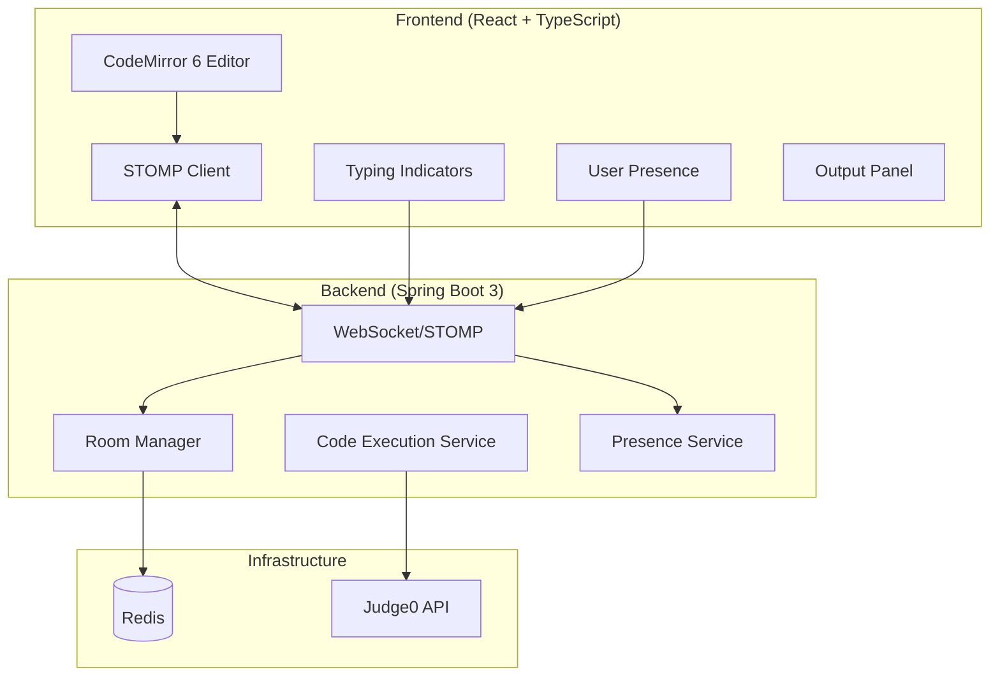

# CodeSync

Real-time collaborative code editor built with Spring Boot and React.

## Architecture



## Features

- Real-time collaborative editing with CodeMirror 6
- Multi-language support (JavaScript, TypeScript, Python, Java, C++, HTML, CSS)
- Code execution via Judge0 API
- Typing indicators and user presence
- Room-based collaboration with unique IDs
- Dark/light theme support
- Responsive design

## Quick Start

### Prerequisites

- Java 21+
- Node.js 18+
- Redis 7+
- Maven 3.9+

### Backend

```bash
cd backend
./mvnw spring-boot:run
```

Backend runs on http://localhost:8080

### Frontend

```bash
cd frontend
npm install
npm run dev
```

Frontend runs on http://localhost:5173

### With Docker Compose

```bash
docker-compose up -d
```

## Environment Variables

### Backend (application.yml)

| Variable | Description | Default |
|----------|-------------|---------|
| `SPRING_PROFILES_ACTIVE` | Active profile | `dev` |
| `REDIS_HOST` | Redis host | `localhost` |
| `REDIS_PORT` | Redis port | `6379` |
| `REDIS_PASSWORD` | Redis password | `` |
| `CORS_ALLOWED_ORIGINS` | Allowed CORS origins | `http://localhost:5173,http://localhost:3000` |
| `JUDGE0_API_URL` | Judge0 API URL | `https://judge0-ce.p.rapidapi.com` |
| `JUDGE0_API_KEY` | RapidAPI key | Required |
| `JUDGE0_API_HOST` | RapidAPI host | `judge0-ce.p.rapidapi.com` |

### Frontend (.env)

| Variable | Description | Default |
|----------|-------------|---------|
| `VITE_API_URL` | Backend API URL | `/api` |
| `VITE_WS_URL` | WebSocket URL | `/ws` |

## Project Structure

```
backend/
├── src/main/java/com/codesync/
│   ├── config/          # WebSocket, Redis configuration
│   ├── controller/      # REST and WebSocket controllers
│   ├── service/         # Business logic
│   ├── model/           # Domain models
│   ├── dto/             # Data transfer objects
│   └── util/            # Utilities
└── src/main/resources/
    ├── application.yml
    └── application-dev.yml

frontend/
├── src/
│   ├── components/      # React components
│   │   ├── editor/      # Code editor components
│   │   ├── sidebar/     # Sidebar components
│   │   └── landing/     # Landing page components
│   ├── hooks/           # Custom React hooks
│   ├── services/        # API and WebSocket services
│   ├── types/           # TypeScript types
│   ├── pages/           # Page components
│   └── utils/           # Utilities
├── index.html
└── vite.config.ts
```

## API Endpoints

### Rooms

- `POST /api/rooms` - Create new room
- `GET /api/rooms/{roomId}` - Get room state
- `DELETE /api/rooms/{roomId}` - Delete room
- `GET /api/rooms` - List all rooms

### Code Execution

- `POST /api/execute` - Execute code
- `GET /api/execute/languages` - Get supported languages

### WebSocket Events

#### Client -> Server

- `/app/room/{roomId}/join` - Join room
- `/app/room/{roomId}/leave` - Leave room
- `/app/room/{roomId}/code` - Send code change
- `/app/room/{roomId}/typing` - Send typing status

#### Server -> Client

- `/topic/room/{roomId}/code-update` - Code changes
- `/topic/room/{roomId}/typing` - Typing indicators
- `/topic/room/{roomId}/user-joined` - User joined
- `/topic/room/{roomId}/user-left` - User left
- `/topic/room/{roomId}/state` - Room state

## Supported Languages

| Language | Judge0 ID |
|----------|-----------|
| Java | 91 |
| Python | 71 |
| C++ | 54 |
| C | 50 |
| JavaScript | 63 |
| TypeScript | 74 |
| HTML | 72 |
| CSS | 73 |

## Development

### Backend Tests

```bash
cd backend
./mvnw test
```

### Frontend Tests

```bash
cd frontend
npm test
```

### Linting

```bash
cd frontend
npm run lint
```

## Deployment

### Backend

Build JAR:
```bash
cd backend
./mvnw clean package -DskipTests
```

Run with Docker:
```dockerfile
FROM eclipse-temurin:21-jre
COPY target/codesync-backend-1.0.0-SNAPSHOT.jar app.jar
EXPOSE 8080
ENTRYPOINT ["java", "-jar", "app.jar"]
```

### Frontend

Build for production:
```bash
cd frontend
npm run build
```

Serve with Nginx:
```dockerfile
FROM nginx:alpine
COPY dist/ /usr/share/nginx/html/
COPY nginx.conf /etc/nginx/conf.d/default.conf
EXPOSE 80
```

## License

MIT