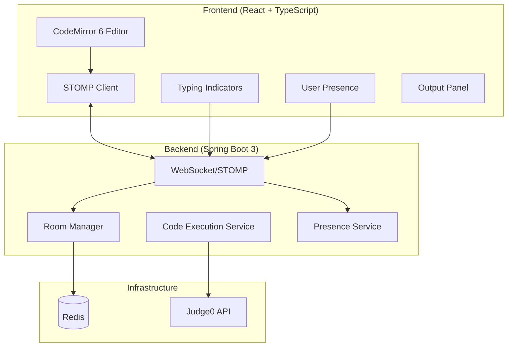

---

# CodeSync

Real-time collaborative code editor built with Spring Boot and React.

[](https://frontend-nine-ashy-94.vercel.app)
[](https://codesync-spir.onrender.com)

---

## Table of Contents

- [Live Demo](#live-demo)
- [Architecture](#architecture)
- [Features](#features)
- [Quick Start](#quick-start)
  - [Prerequisites](#prerequisites)
  - [Backend](#backend)
  - [Frontend](#frontend)
  - [With Docker Compose](#with-docker-compose)
- [Environment Variables](#environment-variables)
  - [Backend (application.yml)](#backend-applicationyml)
  - [Frontend (.env)](#frontend-env)
- [Project Structure](#project-structure)
- [API Endpoints](#api-endpoints)
  - [Rooms](#rooms)
  - [Code Execution](#code-execution)
  - [WebSocket Events](#websocket-events)
- [Supported Languages](#supported-languages)
- [Development & Testing](#development--testing)
  - [Backend Tests (JUnit 5 + Mockito)](#backend-tests-junit-5--mockito)
  - [Frontend Tests (Vitest + React Testing Library)](#frontend-tests-vitest--react-testing-library)
  - [Linting & Type Checking](#linting--type-checking)
- [Deployment](#deployment)
- [UI Screenshots](#ui-screenshots)
- [License](#license)

---

## Live Demo

- **Frontend Application**: [https://frontend-nine-ashy-94.vercel.app](https://frontend-nine-ashy-94.vercel.app)
- **Backend API & WebSocket Service**: [https://codesync-spir.onrender.com](https://codesync-spir.onrender.com)

---

## Architecture



## Features

- Real-time collaborative editing with CodeMirror 6
- Multi-language support (JavaScript, TypeScript, Python, Java, C++, HTML, CSS)
- Code execution via Judge0 API
- Typing indicators and user presence
- Room-based collaboration with unique IDs
- Dark/light theme support
- Responsive design

## Quick Start

### Prerequisites

- Java 21+
- Node.js 18+
- Redis 7+
- Maven 3.9+

### Backend

```bash
cd backend
./mvnw spring-boot:run
```

Backend runs on http://localhost:8080

### Frontend

```bash
cd frontend
npm install
npm run dev
```

Frontend runs on http://localhost:5173

### With Docker Compose

```bash
docker-compose up -d
```

The services will be available at:
- Frontend: http://localhost:3000 (also mapped to http://localhost:5173 and http://localhost:8080)
- Backend API: http://localhost:8081
- Redis: `localhost:6379`

## Environment Variables

### Backend (application.yml)

| Variable | Description | Default |
|----------|-------------|---------|
| `PORT` | Server HTTP port | `8080` |
| `SPRING_PROFILES_ACTIVE` | Active profile | `dev` |
| `REDIS_URL` | Redis connection URL (`rediss://...`) | `` |
| `REDIS_HOST` | Redis host | `localhost` |
| `REDIS_PORT` | Redis port | `6379` |
| `REDIS_PASSWORD` | Redis password | `` |
| `REDIS_SSL` | Enable Redis SSL | `false` |
| `CORS_ALLOWED_ORIGINS` | Allowed CORS origin patterns | `http://localhost:5173,http://localhost:3000,http://localhost:8080,https://*.vercel.app` |
| `JUDGE0_API_URL` | Judge0 API URL | `https://judge0-ce.p.rapidapi.com` |
| `JUDGE0_API_KEY` | RapidAPI key | Required |
| `JUDGE0_API_HOST` | RapidAPI host | `judge0-ce.p.rapidapi.com` |

### Frontend (.env)

| Variable | Description | Default |
|----------|-------------|---------|
| `VITE_API_BASE_URL` | Backend base URL for cloud deployments (e.g. Render) | `` |
| `VITE_API_URL` | Backend API URL override | `/api` |
| `VITE_WS_URL` | WebSocket URL override | `/ws` |

## Project Structure

```
backend/
├── src/main/java/com/codesync/
│   ├── config/          # WebSocket, Redis, CORS configuration
│   ├── controller/      # REST and WebSocket controllers
│   ├── service/         # Business logic
│   ├── model/           # Domain models
│   ├── dto/             # Data transfer objects
│   └── util/            # Utilities
└── src/main/resources/
    ├── application.yml
    └── application-dev.yml

frontend/
├── src/
│   ├── components/      # React components
│   │   ├── editor/      # Code editor components
│   │   ├── sidebar/     # Sidebar components
│   │   └── landing/     # Landing page components
│   ├── hooks/           # Custom React hooks
│   ├── services/        # API and WebSocket services
│   ├── types/           # TypeScript types
│   ├── pages/           # Page components
│   └── utils/           # Utilities
├── index.html
└── vite.config.ts
```

## API Endpoints

### Rooms

- `POST /api/rooms` - Create new room
- `GET /api/rooms/{roomId}` - Get room state
- `DELETE /api/rooms/{roomId}` - Delete room
- `GET /api/rooms` - List all rooms

### Code Execution

- `POST /api/execute` - Execute code
- `GET /api/execute/languages` - Get supported languages

### WebSocket Events

#### Client -> Server

- `/app/room/{roomId}/join` - Join room
- `/app/room/{roomId}/leave` - Leave room
- `/app/room/{roomId}/code` - Send code change
- `/app/room/{roomId}/typing` - Send typing status

#### Server -> Client

- `/topic/room/{roomId}/code-update` - Code changes
- `/topic/room/{roomId}/typing` - Typing indicators
- `/topic/room/{roomId}/user-joined` - User joined
- `/topic/room/{roomId}/user-left` - User left
- `/topic/room/{roomId}/state` - Room state

## Supported Languages

| Language | Judge0 ID |
|----------|-----------|
| Java | 91 |
| Python | 71 |
| C++ | 54 |
| C | 50 |
| JavaScript | 63 |
| TypeScript | 74 |
| HTML | 72 |
| CSS | 73 |

## Development & Testing

### Backend Tests (JUnit 5 + Mockito)

Unit and controller tests are executed via the Maven Wrapper:

```bash
cd backend
./mvnw test
```

To run a specific test class:
```bash
./mvnw test -Dtest=RoomServiceTest
# or
./mvnw test -Dtest=RoomControllerTest
```

Backend test suite covers:
- **`RoomServiceTest`**: Room lifecycle, Redis caching/storage, user join/leave, code/language synchronization.
- **`RoomControllerTest`**: REST API endpoints for room creation, lookup, and 404 handling.
- **`LanguageMapperTest`**: Language ID mapping, case-insensitivity, default fallback, and language support checks.

### Frontend Tests (Vitest + React Testing Library)

Run all frontend tests once (CI mode):
```bash
cd frontend
npm test
```

Run tests in interactive watch mode:
```bash
npm run test:watch
```

Run tests with Vitest visual UI:
```bash
npm run test:ui
```

Frontend test suite covers:
- **`Editor.test.tsx`**: Route handling and editor rendering without crashing.
- **`ErrorBoundary.test.tsx`**: Error boundary fallback UI rendering and recovery buttons.
- **`cn.test.ts`**: Tailwind class name merging, condition resolution, and class precedence.

### Linting & Type Checking

Run ESLint 9 (flat configuration):
```bash
cd frontend
npm run lint
```

Run TypeScript static type checks:
```bash
cd frontend
npx tsc --noEmit
```

## Deployment

### Backend

Build JAR:
```bash
cd backend
./mvnw clean package -DskipTests
```

Run with Docker:
```dockerfile
FROM eclipse-temurin:21-jre
COPY target/codesync-backend-1.0.0-SNAPSHOT.jar app.jar
EXPOSE 8080
ENTRYPOINT ["java", "-jar", "app.jar"]
```

### Frontend

Build for production:
```bash
cd frontend
npm run build
```

Serve with Nginx:
```dockerfile
FROM nginx:alpine
COPY dist/ /usr/share/nginx/html/
COPY nginx.conf /etc/nginx/conf.d/default.conf
EXPOSE 80
```

## UI Screenshots

**Home**


**Collaborate**


**Codespace**


---

## License

MIT
